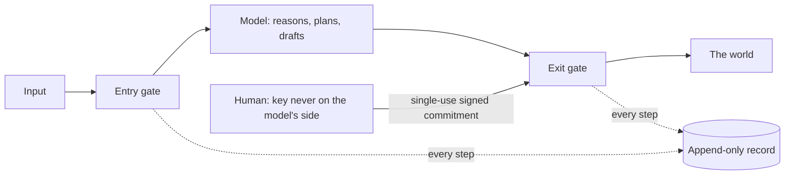
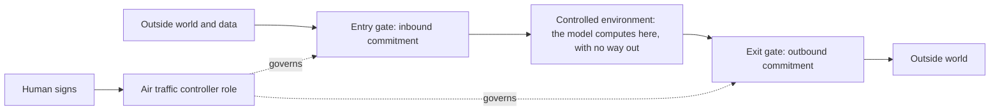

# Governance Above the Model

## A plain-language white paper on the AI paradox, the family of kits that narrows it, and the mechanisms behind each kit

**Jason Blasiak · October 2026 · Patent pending (U.S. provisional application 64/178,949 and others)**

> **How to read this paper.** Part 1 to 4 are for everyone. Part 5 explains each mechanism in enough detail to build it and to see what variations are possible; each mechanism says what the published code does and, separately, what other forms the same idea can take. Part 6 is honest about limits. The published code is the reference for what exists; where this paper describes a variation that the code does not implement, it says so.

**Contents:** [1 The problem](#1-the-problem-in-one-page) · [2 The idea](#2-the-idea-spend-authority-one-action-at-a-time) · [3 The kits](#3-the-family-of-kits) · [4 Which worries it speaks to](#4-which-worries-it-speaks-to) · [5 The mechanisms](#5-the-mechanisms-in-detail) · [6 Limits](#6-what-this-is-not) · [7 Try it](#7-try-it)

---

## 1. The problem in one page

An AI that can only talk is easy to live with. An AI that can *do* things (send the email, move the money, change the file, call the service) is where the trouble starts. We want that power because it is what makes AI useful. We fear it for the same reason.

> **The more an AI can do for you, the more it can do to you.**

The usual answers do not break the paradox. They move it.

- **"We trained it to be careful."** Training changes how likely a model is to behave a certain way. It gives no guarantee, and you cannot inspect it.
- **"We wrote a policy."** A policy is a promise. Nothing stops the model, or a hacker steering it, from acting against it.
- **"The model checks itself."** The thing being checked is the thing doing the checking.
- **"A human reviews everything."** Then the human becomes a bottleneck who stops reading and clicks yes.

What is missing is not a smarter model. It is a way for a person to stay in charge that does not depend on the model behaving.

## 2. The idea: spend authority one action at a time

A bank does not let a teller move a large wire alone. A named person authorises *that* transfer, once, and the bank keeps the record. Governance above the model works the same way:

1. **The model may think freely.** Read, reason, plan, draft. None of that touches the world.
2. **Acting needs a commitment.** A small signed note from a human: *this exact action, these exact details, for a short time, once.* Signed with a key the model never holds.
3. **A gate checks the note.** No note, wrong details, expired or already used: refused. If the gate itself fails: refused. It fails closed.
4. **Everything is recorded** on a chain where each entry holds a fingerprint of the one before. Changing the past breaks the chain, and anyone can check that without trusting us.

Two properties do the work. **Authority is single-use**, so one approval cannot be replayed. **Authority is non-transitive**, so a model, plug-in or another agent cannot create more of it or pass it on.

## 3. The family of kits

Each kit does one job and runs alone. Together they cover the path from "a person decides" to "the world changes" to "anyone can verify what happened". Every kit owns one concern and uses the owner of every other concern instead of growing its own copy; dependencies point only downward.

| Layer | Concern | Kit |
|---|---|---|
| 0 | Records and chain of custody | custody |
| 1 | Human authority: single-use signed commitments, gates | governance-jacket |
| 2 | Layered sealing and proof tiers | superproof |
| 3 | Who is at the door: factors, knowledge questions, assurance levels | identity |
| 3 | Adapters and a dead-end room for the unannounced | pareah |
| 4 | Containment between two gates, with a hard stop (Kronos) | two-gate |
| 5 | Lessons and memory of past incidents | librarian |
| 6 | Deterministic workflow conduct and the library use gate | harness |
| 7 | Knowledge graph with origin and licence per fact | dkg-lattice |
| 8 | Governed training that records what a model learned from | train |
| 9 | Gated command execution | terminal |
| 10 | Telemetry of reasoning, including the harmonic echo | trace |
| 11 | Reasoning fidelity, forecasting (AQUIRE) and the overseer | reasoning |
| 12 | Evidence rungs and the completion gate | metacog |
| 13 | The live governance feed with tamper alarms | governance-feed |
| 14 | Multi-brain council and design-first builder | council |
| 14 | The galaxy view of the knowledge lattice | galaxy |
| 14 | Private verbatim journal with a thought-genome map and Merkle receipts | journal |
| 14 | Governance hardware reference model: enforcement unit, runtime unit, power-cut safe memory | chip |
| 14 | Jurisdictional protocol keys: branch keys, 2-of-3 policy, public veto | jurisdiction |
| 14 | Proof of need and payment from a simulated bankroll, with human-approved releases | proof-of-need |
| 15 | The family as one organism | umbrella |

## 4. Which worries it speaks to

| A common concern | What the design does about it |
|---|---|
| "Who approved that?" | Every action needs a named human's single-use commitment; the record shows which. |
| "Can the AI give itself permission?" | No. Only the human's key signs; authority cannot be passed on. |
| "Can I trust the log?" | You do not have to: each entry fingerprints the one before, and the feed raises an alarm when a chain is cut, rewritten or broken. |
| "What if something hostile connects?" | It is held in the dead-end room and recorded. |
| "What did the model learn from?" | The training record names the data, its licence and the held-out tests. |
| "Did it really read what it says it read?" | Statements that something is absent are held back unless the reading is accounted for. |
| "Is the reasoning settled or lucky?" | The same step is run repeatedly; what stays and what moves is measured. A trace can be made audible so drift sounds dissonant. |
| "Do several models agree, or are they copies?" | The council counts one voice per model family and always carries dissent. |
| "Did the system test its own improvement?" | The overseer promotes a change only after a test, and only a human anchors it. |

## 5. The mechanisms in detail

### 5.0 Where the controls sit: outside the model, between two gates

Most approaches to AI safety try to make the model behave: training, prompts, policies, or a second model checking the first. The design in this paper does something different. **The model is placed between two gates inside a controlled environment, and every crossing is decided by a person's signed commitment, never by the model.**

- **Two commitment gates.** An entry commitment lets named data or context reach the model. An exit commitment lets a named result or action leave. Both are single-use, time-limited and bound to the exact thing they cover.
- **The air traffic controller role.** One governing role decides what may enter and what may leave. It can let new data reach the model so the model can compute with it *before* the exit commitment is authorised, because computing inside the controlled environment changes nothing outside it. Only the exit needs the final signature. The same role handles a **research card**: a commitment scoped to gathering named data, so the model can fetch what it needs without open-ended network access.
- **Not in the model.** The control does not depend on the model's training, honesty or cooperation. A mistaken or manipulated model still cannot cross a gate without a person's signature, and every crossing sits on a hash chain anyone can verify.

**What is code and what is design.** The two-gate corridor (entry gate, contained run, exit review, hard stop) is in the two-gate kit; admission of inbound adapters and the dead-end quarantine are in the pareah kit; the single-use commitment and gate are in the governance-jacket kit. The air traffic controller as one named role and the research card as a named card type describe the architecture those kits implement together; they are not a single module in the published code. This section contrasts the design with prompt-level and policy-level approaches in general terms. It makes no claim about any particular product, and no prior-art search is stated or implied.

### 5.1 The council: equal brains, anonymous review, dissent that cannot be hidden

**The published code** (`vega-council-sdk`). Several brains, each a pair of functions the caller supplies, answer the same prompt with no roles or ranks. Each then sees the *other* answers under shuffled anonymous labels and returns a stance on each: validate, challenge or extend. A brain's stance on its own answer is dropped. Brains of one family count as a single voice per answer, so five copies of one model cannot stuff the ballot. The bar is a majority of families. The outcome is one of CONSENSUS, CONSENSUS_WITH_DISSENT, CONSENSUS_SEVERAL (several answers cleared and none was challenged, so no single winner is invented), SPLIT (a human decides) or INSUFFICIENT. A paid brain is asked only when a human-signed commitment check returns exactly true. The record holds hashes and counts, not answers.

**The design-first builder** in the same kit moves from an approved design to verified work. A person approves the *hash* of the design before any plan exists. Phases run in dependency order. Anything that is a taste decision pauses the build until a person chooses. The brain that built a phase can never verify it, and the verifier must be of a different family; the verifier works from a checklist whose required items must have been expected before the build, coded and passed.

**Variations.** The same structure works with a human as one of the brains; with a quorum of families other than a simple majority; with weighted voices where a family's weight is earned from graded past accuracy; with several rounds of review instead of one; with the anonymising shuffle seeded from something other than the prompt hash; and with the checklist generated by an independent brain before the build. A council can sit in front of any single high-stakes action as an advisory step, with the human signature still deciding.

### 5.2 The governance feed: reading the chains and shouting when one is cut

**The published code** (`vega-governance-feed-sdk`). A feed watches named sources, each a custody chain stored in one or more replica files. On every poll it returns the new events and checks the chain itself. It raises a critical alarm for CHAIN_BROKEN (an entry edited, replicas disagreeing or a file unreadable), CHAIN_SHORTENED (the newest entries were cut off) and CHAIN_REWRITTEN (the entry at a remembered position is no longer the same one). An alarm is raised once per distinct problem. While a source is in alarm its cursor does not advance, so nothing is silently skipped. Event summaries are built only from an allow-list of fields, scrubbed of credential-shaped text and terminal escape codes, and cut short; the full entry stays on the chain. The feed reads and never writes.

**Variations.** The same watching can be done by a second process on another machine holding its own replica (so cutting the chain on one machine is caught from another); alarms can feed the hard stop (the trace kit's telemetry can *cue* a hard stop but never grants or withdraws authority); sources can be any append-only ledger with a verify function, not only the custody chain; and the display can be a terminal, a web page or an audible alert.

### 5.3 The overseer: promote by test, anchor only by a human

**The published code** (`vega-reasoning-sdk`, `overseer`). A candidate change is built and tested. If it builds and passes it is NOURISHING; if it fails to build or fails the test it is SICK; if it builds, does not pass and names what is missing it is HUNGRY. A NOURISHING verdict becomes PROMOTED only when a co-sign function, wired by the caller to a human-signed commitment for exactly that verdict hash, returns exactly true. Without it the candidate stays PROPOSED. The overseer digests and proposes; it never anchors its own findings, so it cannot feed itself flattering results.

**Variations.** The test can be a held-out benchmark, a red-team script or a clean-room behavioural comparison; the verdict can carry a score instead of three states; several overseers of different families can digest the same candidate and the council logic can combine them; and a promoted change can be rolled back by the same commitment mechanism.

### 5.4 The forecaster (AQUIRE): reason over a distribution, not one answer

**The published code** (`vega-reasoning-sdk`, `aquire`). It is quantum-inspired in philosophy and entirely classical in implementation: no quantum hardware or speed-up is claimed. `forecast` runs a weighted multi-path beam search forward over a graph of possible next steps and returns a distribution of outcomes, its entropy in bits, the best path by a max-product search and the probability mass the beam kept. The mass the beam threw away is reported, so a narrow beam cannot pass for certainty. `collapse` picks an outcome only when the stated requirements leave exactly one; none gives NONE, several gives AMBIGUOUS, and nothing is chosen. The galaxy kit uses the same forecast to show *what could happen* from above, and finds *what must happen* from below by removing each ancestor and checking whether the goal is still reachable.

**Variations.** The graph can be built from the knowledge graph, from historical runs recorded by the librarian, or from a plan; weights can come from observed frequencies or from graded confidence; the beam width and depth can adapt to the stakes; and the requirements can be human-written, council-written or derived from the commitment being asked for.

### 5.5 The harmonic echo: making a trace audible

**The published code** (`vega-trace-sdk`, `harmonic`). A metamorphosis record, which holds a digest and a norm of the state at each layer, is turned into a melody. Each layer's pitch is a semitone offset of 12 times the base-2 logarithm of its output norm over its input norm, clamped to plus or minus 24 and set above a base of 220 Hz. A layer whose output digest equals its input digest changed nothing; a run of those is the "stuck noise". Dissonance is the share of consecutive intervals that are not consonant (unison, thirds, fourth, fifth, sixths and octave count as consonant). Clarity is 1 minus 0.6 times dissonance minus 0.4 times the stuck share, with verdicts STUCK, CLEAR, MUDDY or DISSONANT. A rendered WAV is deterministic, length-capped and made only from the record, so raw activations are never needed or stored.

**Honest status.** The mapping from numbers to notes is a convention chosen here, not a discovered law. That a clear sound goes with a correct answer is a hypothesis; `compare_clarity` exists to test it on recorded passes and reports the difference with counts, nothing more.

**The repeat-run echo** (`echo`) is a separate, complementary test: ask the same governed step several times under controlled variation and read what stays (the fundamental: words every run contains) and what moves (the overtones). Resonance is the shared share of all words seen; a step that echoes UNSTABLE is one the reasoning has not settled on, however confident any single run sounded. The kit never calls a model; the caller passes a function.

**Telemetry by access tier** (`tiers`). With the weights, per-token traces through the layers are possible. With only output probabilities, per-token entropy is the signal. With text only, no internal trace exists and only external observation (timing, resource use) is possible. A lower tier is never padded with what only a higher tier could know.

**The reference signature** (`signature`). Telemetry of assertions verified by two independent sources forms a reference signature for a model, optionally per subject domain. Every other assertion gets an asserted value: its measured distance from that signature, so a reader or listener can sense each unverified assertion against "the sound of verified fact". The signature changes only by committed additions. The asserted value informs; verification decides.

**Variations.** Other mappings from numbers to sound (rhythm for timing, timbre for entropy, stereo position for family); a visual rendering of the same record as a 3D path; thresholds learned per model instead of fixed; and the signal used as one input among several to *cue* a hard stop or to ask for a council review, never to grant authority.

### 5.6 Containment (Kronos), the hard stop and the dead-end room

**Two-gate containment** (`vega-two-gate-sdk`). A job runs in a separate process with a stripped environment, a throwaway working directory, a wall-clock timeout and an output cap. At the entry gate only a verified request with a job-bound, single-use human commitment starts it. At the exit the output is reviewed before release and leaves only as a chained capsule, and only after the working directory is confirmed gone. A kill that cannot be confirmed is reported and stops everything. The hard stop is a one-way ratchet: anyone or anything can engage it, nothing runs while engaged, and only a valid human signature for exactly that action lifts it.

**The dead-end room** (`vega-pareah-sdk`). An adapter admits what the owner announced. Anything else is held in a room that holds nothing, answers from a fixed script and can reach nothing, so an unknown agent learns nothing and takes nothing.

**Variations.** An operating-system sandbox or container behind the same two gates; the room recording what a visitor does so it can be studied; a visitor handed an automatic hard-stop cue when it probes; and the same corridor drawn as a live picture of the two gates with the commitments the model holds.

### 5.7 Seeing who is at the door (identity)

**The published code** (`vega-identity-sdk`). Factors: password, authenticator-app codes with QR set-up, one-time phone codes, voice or biometric match, and questions built from the user's own knowledge graph that only that user would know. Each action carries an assurance level it needs, and the service combines factors to meet it. Phone challenges are bound to their user, limited in attempts and sends, and burned on use; knowledge questions are burned at the moment they are shown and lock out with growing delays. Account recovery is not built and needs a human in the loop.

### 5.8 Keys that the model cannot read (key cards and broker)

**Design and reference code** (`vega-keyring-sdk`). An API key lives on an encrypted card (AES-256-GCM, with the card's hosts, header, mode and limits authenticated so it cannot be repointed). A broker lets the model *ask* for a call and never *read* the key: it checks the target and headers, requires a human approval for that exact call and a fresh nonce, records the intent before sending, decrypts the key in memory for that call only, scrubs it from the response and wipes it. A provider must receive the real key or a token it issued, so homomorphic encryption cannot make a leaked live key useless; where a provider can issue short-lived tokens, the card holds the long-lived secret offline and mints a single-use credential per approval.

### 5.9 A copilot chat the AI cannot act through

**Design and reference code** (`vega-copilot-sdk`). The AI can talk, read and propose. A proposal that would change something shows its exact effect (computed by the tool, not the AI), has frozen parameters and waits for one human approval before it expires. Tool output is data and can never approve anything. Every line is on a hash chain with a gate badge, credential-shaped text is replaced before it is shown or recorded, and a hard stop blocks everything and fails closed.

### 5.10 Learning from what went wrong

The librarian keeps graded lessons: what happened, the root cause, the correction, the prevention and the proof it works. Before a risky action the harness asks for lessons about that kind of action. The training kit records exactly what a model learned from, including keeping test data separate. The knowledge graph attaches origin and licence to each fact so that use can be gated. The repo library use gate decides, by licence class, whether code may be used directly, only inside quarantine, or only through a clean-room method, and everything derived from a read stays marked until a clean-room step releases it.

## 6. What this is not

- **It does not make a model aligned, truthful or kind.** It limits what a model can do, not what it believes.
- **It is not a finished product.** These are working reference implementations with tests. They show the architecture; they are not hardened for production.
- **No expert has reviewed the cryptography.** The code is plain software written for clarity. Do not protect real secrets with it before an independent review.
- **Several mechanisms are hypotheses.** The harmonic echo's link between clarity and correctness, and the reference signature's link between distance and truth, are tested by built-in comparison functions and are not established findings.
- **The hardware parts are designs, not chips.**
- **The human is still the weak point.** If a person approves carelessly, the gate cannot help.
- **The law is not settled.** The licence is a draft that no attorney has reviewed, and nothing here is legal advice.

## 7. Try it

Start with **vega-umbrella-sdk** for the map, then **vega-governance-jacket-sdk** for the commitment and the gate. Each kit has a README with a quick start, a specification, an architecture file with diagrams of its fail-closed points, and a capability inventory.

**Licence.** Source-available. Free for personal use and for registered small businesses; otherwise a commercial licence. See the LICENSE file in each repository. Commercial and registration questions: jasonblasiak.ai.mail@gmail.com.

---

*This paper describes the design and the reference code. It makes no claim about any particular deployment.*
